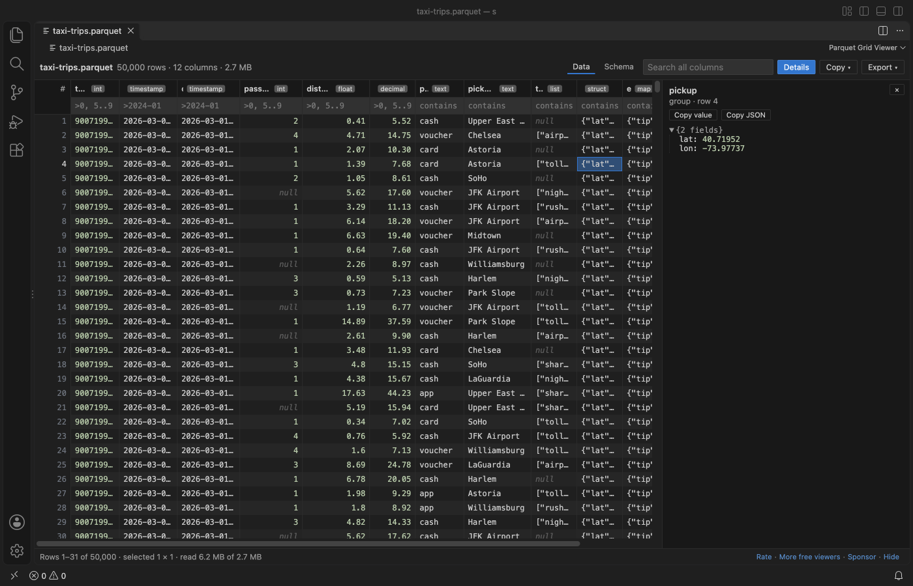
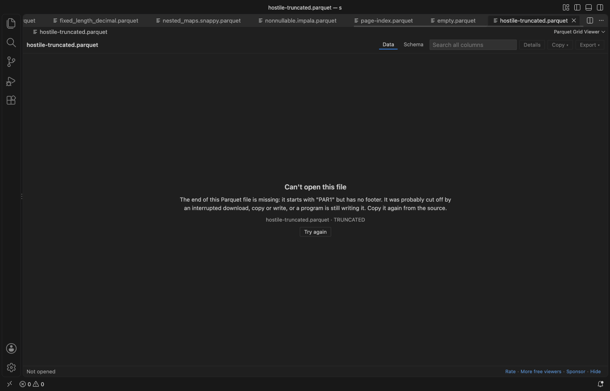
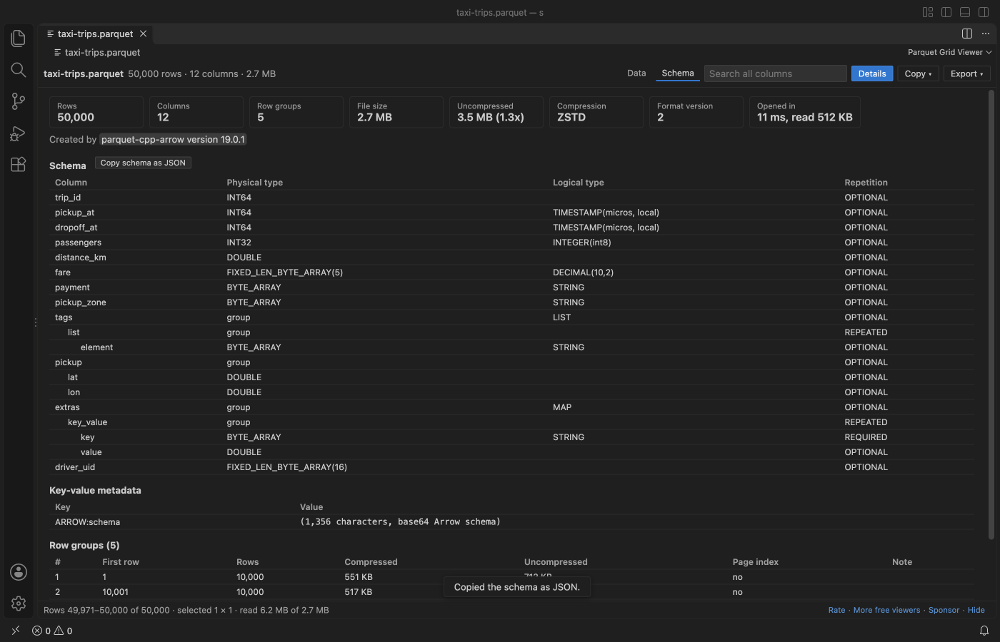

# Parquet Grid Viewer (Large File Explorer, Schema & Nested Data)

Open `.parquet`, `.parq` and `.pq` files in VS Code as a fast, sortable grid. Free, no sign-in, works offline. No Python, no parquet-tools, no Java and no native modules: it is plain JavaScript, so it runs the same on Windows, macOS (Apple silicon too), Linux, Remote SSH, WSL and Codespaces.

- Large files open at once. Opening reads the footer only (the 2.7 MB file in the picture opened in 11 ms after reading 512 KB), and rows are read in blocks as they scroll into view, in a background thread, so VS Code never freezes.
- Exact values. DECIMAL up to 38 digits, INT64 and UINT64 above 2^53, and nanosecond timestamps show every digit. INT96 timestamps from Spark and Hive are read too.
- Nested data. LIST, MAP and STRUCT columns show as compact JSON in the grid and as an expandable tree in the detail pane.
- Every codec. Snappy, Gzip, Zstd, Brotli, LZ4 and LZ4_RAW, data pages v1 and v2, dictionary, delta and byte-stream-split encodings.

What you can do with the rows:

- Filter, sort and search on the whole file, not only the rows on screen. Copy cells or rows as CSV, JSON or a Markdown table, and export the filtered rows to CSV or JSON Lines.
- Schema tab with every column type, the row groups, compression, page index and key-value metadata, and Copy schema as JSON.
- Clear messages for files that are cut off, damaged, encrypted or not Parquet at all, instead of a blank tab or a spinner that never ends (below: a file cut off in the middle).

- Dark, light and high-contrast themes follow VS Code.

## How to use it

1. Click a Parquet file in the Explorer. It opens in the grid. (Right-click a file and pick Open in Parquet Grid Viewer if another editor is the default.)
2. Click a column header to sort (again for descending, a third time to clear).
3. Type in the box under a header to filter that column:

| You type | Rows shown |
| --- | --- |
| `air` | the value contains "air" (any case) |
| `=cash` | the value is exactly "cash" |
| `!night` | the value does not contain "night" |
| `>100`, `<=0.5` | numeric compare in number columns, text compare in others |
| `5..9`, `2026-03-01..2026-03-31` | between, both ends included |
| `null`, `!null` | empty or not empty |
| `/^JFK\|LGA/` | a regular expression |

4. The search box at the top looks in every column, nested ones too.
5. Click a cell and press Enter (or click Details) to see the whole value. Nested cells open as a tree.
6. Select cells with the mouse, Shift+click or Shift+arrows, or click row numbers for whole rows. Copy puts them on the clipboard as CSV, JSON or Markdown. Ctrl+C (Cmd+C) copies tab-separated text for a spreadsheet.
7. Export saves every row of the current view (filters and sort applied) as CSV or JSON Lines.

## Large files

Opening a file reads the footer only. Rows are read in blocks as they scroll into view, from the row group that holds them: 2,000 rows at a time when the file has a page index (then only the needed pages are read), bigger blocks when it has none. Up to about 1.5 million decoded cells stay in memory; older blocks are dropped.

Filter, sort, search and export read the needed columns of every row group in turn, in a background thread, with a progress bar and a Cancel button. Sorting keeps one column of the matching rows in memory, so it stops at 2,000,000 rows (setting `parquetViewer.maxSortRows`); filter first to sort part of a bigger file.

| Setting | Default | What it does |
| --- | --- | --- |
| `parquetViewer.maxSortRows` | 2,000,000 | most rows a sort works on |
| `parquetViewer.maxMatches` | 5,000,000 | filters and search stop after this many matches |
| `parquetViewer.maxCopyRows` | 100,000 | most rows copied at once (export has no limit) |
| `parquetViewer.maxFooterMB` | 256 | larger metadata shows a message |
| `parquetViewer.maxChunkMB` | 2,048 | a larger column chunk shows a message |
| `parquetViewer.maxVirtualFileMB` | 512 | files on remote or virtual file systems are read whole up to this size |

## Why this one

People reported these problems with Parquet viewers on the Marketplace. Each one is covered by a test in this repo or by the real VS Code check before release.

| Reported problem | Here |
| --- | --- |
| Large files keep loading or never open ([1](https://github.com/dvirtz/vscode-parquet-viewer/issues/85), [2](https://github.com/dvirtz/vscode-parquet-viewer/issues/81), [3](https://github.com/dvirtz/vscode-parquet-viewer/issues/79)) | only the footer is read on open, then the rows on screen, in a background thread; damaged files get a message, not a spinner |
| "invalid parquet type: DECIMAL" ([1](https://github.com/dvirtz/vscode-parquet-viewer/issues/88), [2](https://github.com/dvirtz/vscode-parquet-viewer/issues/64), [3](https://github.com/dvirtz/vscode-parquet-viewer/issues/34)) | DECIMAL in INT32, INT64, FIXED_LEN_BYTE_ARRAY and BYTE_ARRAY, exact to 38 digits |
| ZSTD, Gzip, Brotli or LZ4 files fail ([1](https://github.com/dvirtz/vscode-parquet-viewer/issues/90), [2](https://github.com/dvirtz/vscode-parquet-viewer/issues/102), [3](https://github.com/AdamViola/parquet-explorer/issues/22)) | all of them, checked to give the same rows |
| Needs parquet-tools, Python or a native module, fails on Windows or Apple silicon ([1](https://github.com/dvirtz/vscode-parquet-viewer/issues/16), [2](https://github.com/dvirtz/vscode-parquet-viewer/issues/121), [3](https://github.com/dvirtz/vscode-parquet-viewer/issues/83)) | plain JavaScript, nothing to install |
| Integers above 2^53 show the wrong value ([1](https://github.com/AdamViola/parquet-explorer/issues/32)) | INT64 and UINT64 are exact, in the grid, in copy and in export |
| Struct columns are not shown ([1](https://github.com/AdamViola/parquet-explorer/issues/15)) | LIST, MAP and STRUCT, any depth, with a tree view |
| `.parq` files do not open ([1](https://github.com/AdamViola/parquet-explorer/issues/18)) | `.parquet`, `.parq` and `.pq` |
| Column names with `%` or file names with `'` break ([1](https://github.com/AdamViola/parquet-explorer/issues/35), [2](https://github.com/AdamViola/parquet-explorer/issues/33)) | tested with a file named `it's 100% names.parquet` |
| No total row count or filtered count ([1](https://github.com/AdamViola/parquet-explorer/issues/12)) | both, in the toolbar and the status bar |
| A review says the viewer asked for payment ([reviews](https://marketplace.visualstudio.com/items?itemName=dvirtz.parquet-viewer&ssr=false#review-details)) | free, with no paid tier and no license key |

## Privacy

The viewer makes no network requests. The webview's content security policy is `default-src 'none'`, scripts run only with a per-page nonce, and there is no telemetry. The file is opened read-only and is never changed. The only links that leave VS Code are the Rate, Sponsor and More free viewers links, and only when you click them.

## Limits

- Encrypted Parquet files (Parquet Modular Encryption) show a message: the viewer does not ask for keys.
- Files whose column chunks live in other files (`file_path` in the metadata) are not supported.
- Remote and virtual file systems have no range reads, so those files are read whole, up to `parquetViewer.maxVirtualFileMB`.
- The viewer is read-only. To change data, use your usual tool (pandas, Polars, DuckDB, Spark).

## Credits

Parquet decoding by [hyparquet](https://github.com/hyparam/hyparquet) and [hyparquet-compressors](https://github.com/hyparam/hyparquet-compressors) (MIT). Test files include samples from [apache/parquet-testing](https://github.com/apache/parquet-testing) (Apache-2.0). See THIRD-PARTY-NOTICES.txt.

## Support Zovo

Zovo extensions are free, with no ads and no tracking. They are made by [theluckystrike](https://github.com/theluckystrike) on GitHub. If this one saves you time, you can support the work:

- [Sponsor on GitHub](https://github.com/sponsors/theluckystrike)
- [PayPal](https://www.paypal.com/paypalme/najzzz)
- [Follow theluckystrike on GitHub](https://github.com/theluckystrike)

## More tools by Zovo

- [XLSX Viewer & CSV Preview for Excel, XLS & Parquet](https://marketplace.visualstudio.com/items?itemName=zovo.table-viewer-vscode) opens CSV, TSV, Excel and Parquet files as a sortable, filterable table.
- [JSONL Viewer, Large JSONL Table & NDJSON Viewer](https://marketplace.visualstudio.com/items?itemName=zovo.zovo-jsonl-viewer) opens JSONL and NDJSON files as a table, as records or as a chat view.
- [SQLite Viewer & SQLite3 DB File Browser, Database Explorer](https://marketplace.visualstudio.com/items?itemName=zovo.sqlite-table-viewer) browses SQLite tables read-only and runs SELECT queries.
- [Avro Viewer, Apache Arrow Viewer & Feather Viewer](https://marketplace.visualstudio.com/items?itemName=zovo.arrow-avro-viewer) opens Avro, Arrow and Feather files as a paged table.
- [GeoJSON Viewer, KML Viewer & GPX Viewer (Map Preview, Shapefile)](https://marketplace.visualstudio.com/items?itemName=zovo.zovo-geo-map-viewer) GeoJSON viewer, KML viewer and GPX viewer with a map preview in VS Code. Also opens shapefiles (SHP, zipped), KMZ, TopoJSON, WKT and CSV with lat/lon: feature table, properties, GPX distance and elevation profile, reprojection from .prj, PNG export. Free, no sign-in, works offline.

See [all Zovo extensions on the Marketplace](https://marketplace.visualstudio.com/publishers/zovo).
